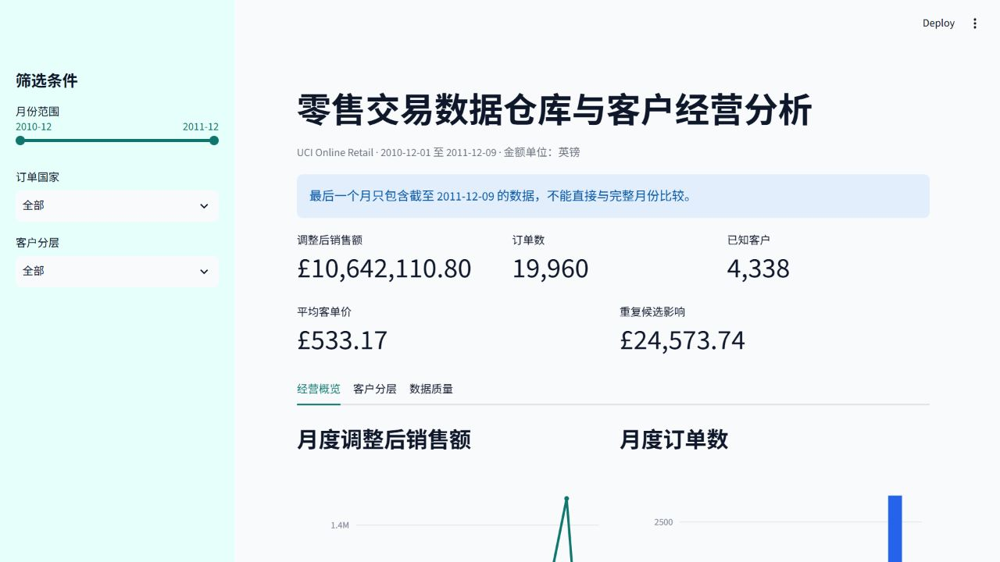
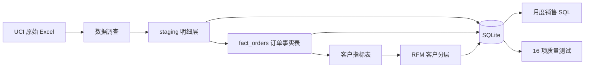

# 零售交易数据仓库与客户经营分析

一个可重复运行的本地数据工程项目：从 541,909 条零售交易明细出发，完成数据调查、质量标记、订单事实表、客户 RFM 分层、SQLite 装载、SQL 报表和自动化质量测试。

项目同时提供 Streamlit 交互式仪表盘，用于查看月度趋势、国家销售、客户分层和质量测试状态。

GitHub Actions 会在每次推送和拉取请求中运行不依赖原始 Excel 的单元测试。

## 仪表盘预览

默认筛选覆盖全部月份与国家，展示整体订单、客户与销售指标。



## 项目结果

| 指标 | 结果 |
|---|---:|
| 原始明细 | 541,909 行 |
| 有效销售明细 | 530,104 行 |
| 订单事实表 | 19,960 张订单 |
| 已知客户 | 4,338 人 |
| 匿名订单 | 1,428 张 |
| 观察销售额 | 10,666,684.54 |
| 重复候选影响金额 | 24,573.74 |
| 调整后销售额 | 10,642,110.80 |
| SQL 数据质量测试 | 16/16 通过 |

最近一次本机完整重建耗时 32.0 秒。该数字只用于说明本次运行结果，不代表其他机器的性能。

## 数据链路



流水线入口 `run_pipeline.py` 依次执行第 5～11 课的构建脚本。任一步骤返回非零退出码时立即停止，并将步骤状态、耗时和退出码写入 `reports/12_pipeline_run_summary.csv`。

启动前会核对原始 Excel 的 SHA-256，防止在源文件改变后继续沿用旧的回归基准。

## 核心口径

### 有效销售

有效销售明细需要同时满足：发票号不以 `C` 开头、`Quantity > 0`、`UnitPrice > 0`。

缺少 `CustomerID` 的交易仍计入整体订单和销售额，但不进入客户级指标与 RFM 分层。

### 重复候选

原始数据中有 5,268 条第二次及以后出现的完全相同明细。数据没有明细唯一编号，无法证明这些记录全部是误录，因此 staging 层保留原记录并添加 `is_exact_duplicate_extra` 标记。

订单事实表同时保存：

- `observed_sales_amount`：保留全部有效销售明细的观察金额；
- `duplicate_candidate_amount`：额外完全重复候选对应的金额；
- `adjusted_sales_amount`：排除重复候选后的敏感性结果。

### 订单粒度

一行订单事实代表一个 `InvoiceNo`。有 42 张发票包含多个相邻交易时间，但同一发票内客户与国家一致，因此保留开始时间、结束时间和多时间标记，不把它们拆成额外订单。

### RFM

RFM 的参考时间是数据集中最后一次交易时间加一天，而不是运行程序的当前日期。评分阈值来自数据四分位点，并使用固定值域规则处理大量并列的单订单客户。

RFM 标签是描述性分析规则，不是客户行为预测，也没有经过营销实验验证。

## 数据质量

`sql/quality/01_core_quality_checks.sql` 包含 16 项检查，覆盖：

- staging、订单和客户表行数回归；
- 源行号、订单号和客户号唯一性；
- 明细金额计算一致性；
- 取消发票与取消标记一致性；
- 观察金额、重复候选金额与调整后金额对账；
- 订单到客户表的关联完整性；
- RFM 分数范围与分层非空检查；
- 调整后总销售额回归。

任意测试失败时，质量测试脚本以非零状态结束，从而中断流水线。

## 目录结构

```text
project1-retail-warehouse/
├── data/
│   ├── raw/                 # 原始数据来源说明；Excel 不提交 Git
│   ├── staging/             # 流水线生成，不提交 Git
│   └── mart/                # 流水线生成，不提交 Git
├── lessons/                 # 从调查到数仓的逐步学习脚本
├── dashboard/               # Streamlit 交互式分析界面
├── tests/                   # 可在 CI 中独立运行的业务规则测试
├── reports/                 # 小型结果报告与流水线运行记录
├── sql/
│   ├── analysis/            # 分析查询
│   └── quality/             # 数据质量测试
├── warehouse/               # 本地 SQLite 数据库，不提交 Git
├── requirements.txt
└── run_pipeline.py
```

## 运行方法

### 1. 创建环境并安装依赖

```powershell
python -m venv .venv
.\.venv\Scripts\Activate.ps1
python -m pip install -r requirements.txt
```

### 2. 准备原始数据

从 [UCI Online Retail 数据页面](https://archive.ics.uci.edu/dataset/352/online+retail) 下载数据，解压后将 `Online Retail.xlsx` 放到 `data/raw/`。

预期 SHA-256：

```text
43465A06F2CCF7C8B5BD2892BC7DEFB52F97487934FE93B16AE4C3936424676D
```

来源、许可、文件大小和 DOI 记录在 `data/raw/SOURCE.md`。

### 3. 执行完整流水线

```powershell
python run_pipeline.py
```

成功时会显示 7 个步骤全部为 `PASS`，并生成：

- `data/staging/online_retail_staging.csv`
- `data/mart/fact_orders.csv`
- `data/mart/mart_customer_metrics.csv`
- `data/mart/mart_customer_rfm.csv`
- `warehouse/retail_warehouse.db`
- `reports/10_monthly_sales.csv`
- `reports/11_data_quality_results.csv`
- `reports/12_pipeline_run_summary.csv`

### 4. 启动交互式仪表盘

```powershell
python -m streamlit run dashboard/app.py
```

仪表盘包含月份、国家和客户分层筛选，可查看经营概览、客户 RFM 和 16 项数据质量测试。最后一个月只覆盖到 2011-12-09，界面会显示边界月份提醒。

### 5. 运行单元测试

```powershell
python -m unittest discover -s tests -v
```

这些测试使用内存中的小型样例，检查记录分类优先级、独立质量标记、有效销售筛选和重复候选金额对账，因此不需要下载原始 Excel。

## 技术栈

- Python 3.13
- pandas 2.3.3
- openpyxl 3.1.5
- SQLite / SQL
- Streamlit 1.64.0
- Plotly 7.1.0
- GitHub Actions
- PyCharm

## 已知限制

- 数据没有商品成本，项目计算的是销售额，不能据此声称利润。
- 完全相同明细缺少唯一行号佐证，因此只做重复敏感性分析。
- 2011 年 12 月只覆盖到 12 月 9 日，不能直接与完整月份比较。
- 客户国家取最近订单国家，同时保留多国家标记；它不等同于永久居住地。
- 当前 SQLite 实现适合本地复现和作品展示，不代表分布式生产数据仓库。

## 数据来源

Chen, D. (2015). *Online Retail* [Dataset]. UCI Machine Learning Repository. [DOI: 10.24432/C5BW33](https://doi.org/10.24432/C5BW33). License: CC BY 4.0.
